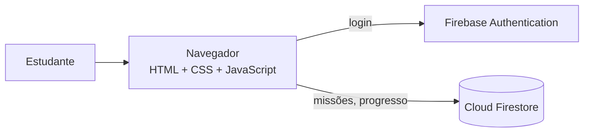

# Arquitetura

> Rascunho. Ajuste conforme a implementação real.

## Visão geral

Aplicação web estática (HTML, CSS e JavaScript) que roda no navegador. A persistência e a autenticação ficam no Firebase, sem servidor próprio.

## Decisões técnicas

| Decisão | Justificativa |
|---|---|
| Site estático | Simples de publicar no GitHub Pages e sem custo de servidor |
| Firebase | Oferece login e banco NoSQL sem precisar construir um back-end |
| Cloud Firestore | Os dados (missões com etapas) cabem bem em documentos |
| Regras de segurança por usuário | Cada pessoa lê e grava só os próprios dados |

## Estado atual

O protótipo cobre telas e navegação. A integração com Firebase está **planejada** (veja o cronograma na página do projeto).

<!-- TODO: se já integrou o Firebase, atualize esta seção -->
